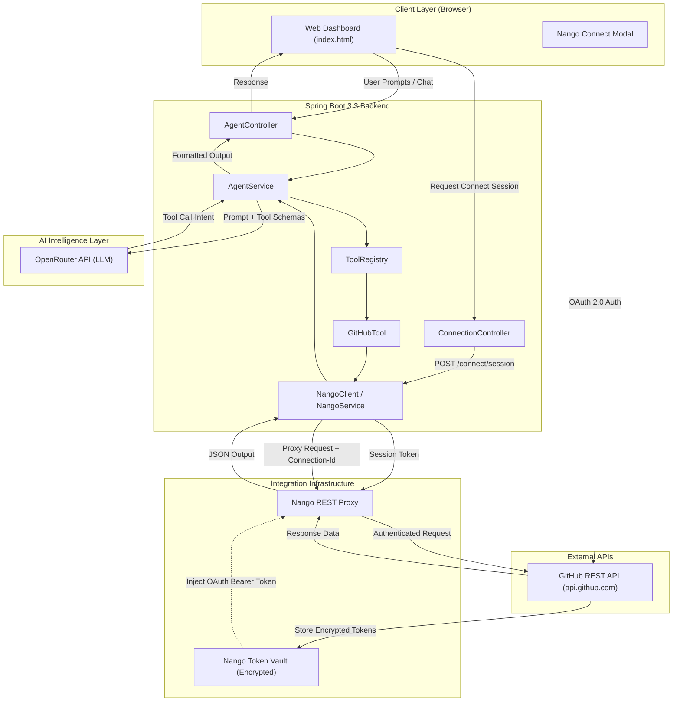
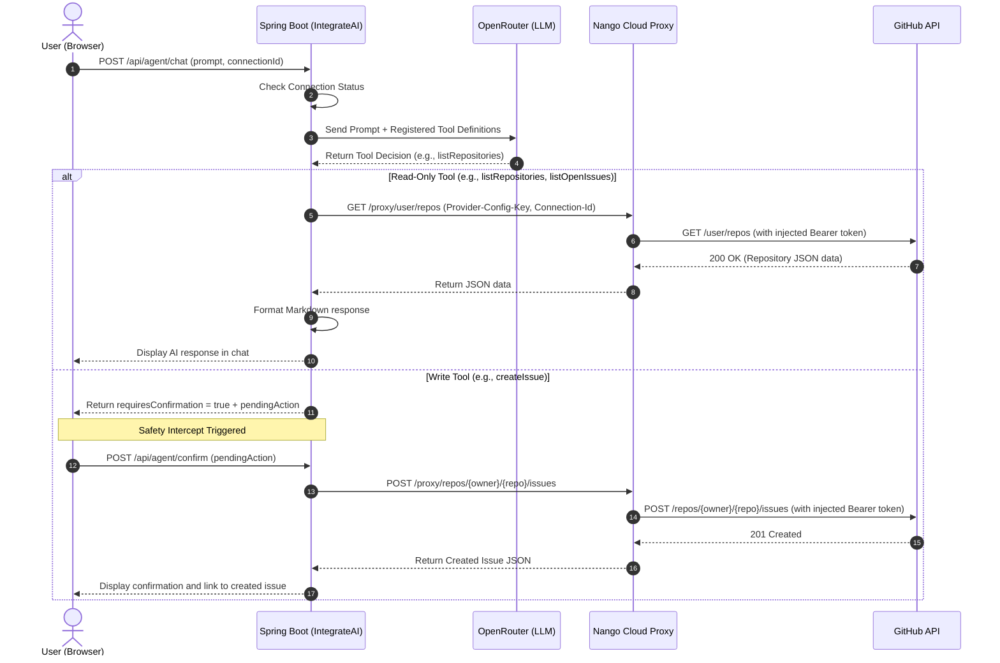
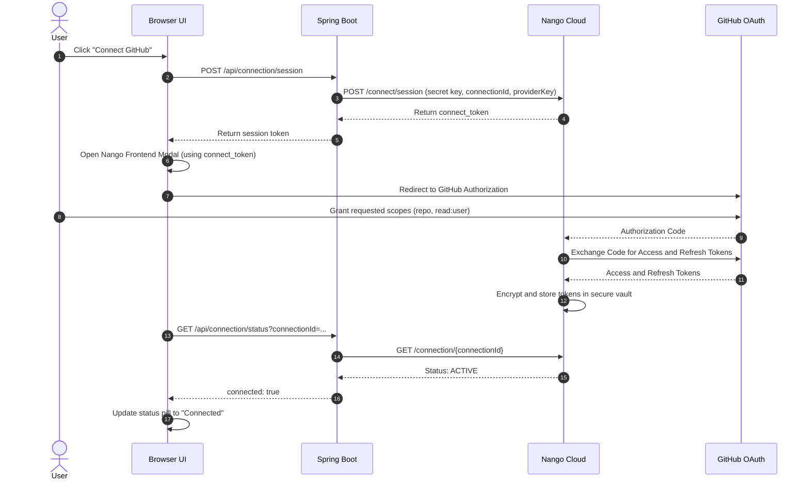
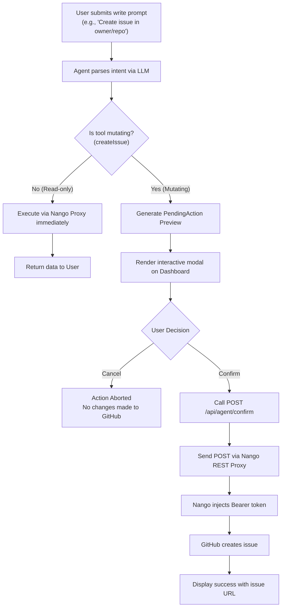

# IntegrateAI Architecture and Flowcharts

This document details the architectural diagrams and technical interaction flows for IntegrateAI.

---

## 1. System Architecture

---

## 2. Request and Tool Execution Flow

---

## 3. OAuth Handshake Flow

---

## 4. Safety Confirmation Intercept Flow

